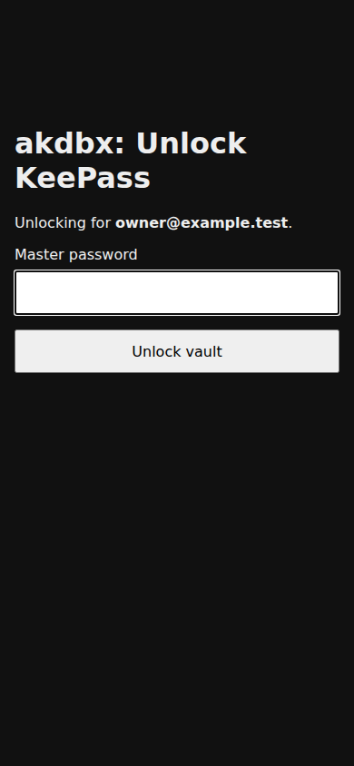
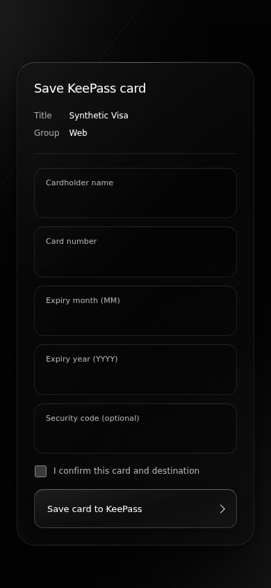

# Private portal design

The unlock and private save/import portals share the black frosted glass design
from agentic-handoff: a translucent black sheet, soft white lighting, a fine grain,
white field borders and glass buttons. The document keeps its AKDBX identity;
each form keeps its destination details, warnings and confirmation controls.

The shared renderer covers unlock, password save, card save, authenticator setup,
QR import, import review and result/error pages. Labels are associated with their
inputs. Form names, types, limits, autocomplete hints and submission routes are
preserved. The existing response security headers remain in effect. The design
uses inline CSS/SVG and system fonts, with no remote assets. A hash-authorized
presentation script controls password visibility, unlock feedback and card save
feedback. Standard form encoding is used only for the same-origin unlock and card
POSTs. The script reads input values only to check card details on the page
(`portal.CARD_CHECK`, the same rules and messages as the broker) and to keep the
non-secret title and group after a final result; it never shows, logs or stores
a card value. Normal pages allow only this exact script. Import pages
also retain their existing same-origin QR scripts.

The card save page reuses the unlock button component (`.portal-submit` with
`.portal-progress`): it is disabled with an indeterminate bar while saving, then
shows `Saved`, or a dashed error state (`Page expired`, `Vault changed`,
`Cancelled`, `Not confirmed`). A broker refusal of the form, such as a duplicate
title, returns the button to `Save card to AKDBX` with the message below it.
Each server result carries `data-card-result`, so the page shows the real
broker state; a lost response reports that the result is not confirmed.

Motion follows the original design: an 800 ms sheet entrance, staggered fields,
slow ambient lighting and a subtle button glint. These effects run only with
`prefers-reduced-motion: no-preference`.

Password fields have a keyboard-accessible eye button with a stable accessible
name and a pressed state that means visible. Values start hidden, and are hidden
again on submission and history restoration. The manual import field stays
unnamed so it cannot be added to the native import payload.

A valid unlock submission immediately depresses the glass button and displays an
indeterminate bar clipped inside its unchanged dimensions. Duplicate submissions
are blocked while the same-origin POST is pending. The status is announced outside the
busy form; no percentage or inferred success is shown. Reduced motion keeps a
static bar. The real server response replaces the form: a failed password or rate
limit returns a fresh, empty retry form, and success shows the AKDBX ready message.
A network failure clears the form, restores enabled controls, and visibly reports
that the unlock result is not confirmed. It does not retry or claim an unlock.

## Before and after

These screenshots use real HTTP-handler responses from an isolated synthetic
test vault. All entry/account details are synthetic, and secret fields are empty.
The baseline is commit `64713227a551890f3f59bfee5ac89fdc0050848b`.
The live broker was not changed or restarted for this review.

Mobile viewport: 390 × 844. Full-page captures retain scrolling content.

| Portal | Before | After |
| --- | --- | --- |
| Unlock |  |  |
| Card save |  |  |

Desktop viewport: 1280 × 900.

| Before | After |
| --- | --- |
|  |  |

## Validation

- 277 existing focused tests passed across web unlock, private writes, cards,
  authenticators, imports and upload contracts. One additional synthetic handler
  capture check passed (278 checks in that run).
- Chromium checked eight portal states at 320, 390 and 1280 pixels wide: unchanged
  form contracts, associated labels, no horizontal overflow and disabled motion
  under the reduced-motion preference.
- The raw captures and browser-check reports are kept in the local ignored
  `evidence/` directory; only the six synthetic review images are included here.

The existing regression tests can be run with:

```sh
python -m pytest -q tests/test_web_unlock.py tests/test_writes.py \
  tests/test_cards.py tests/test_totp.py tests/test_import_totp.py \
  tests/test_upload_contract.py
```

The portal interaction regression checks use only new synthetic fixtures and an
isolated browser profile/X server:

```sh
python -m pytest -q tests/test_portal.py tests/test_portal_browser.py
```
