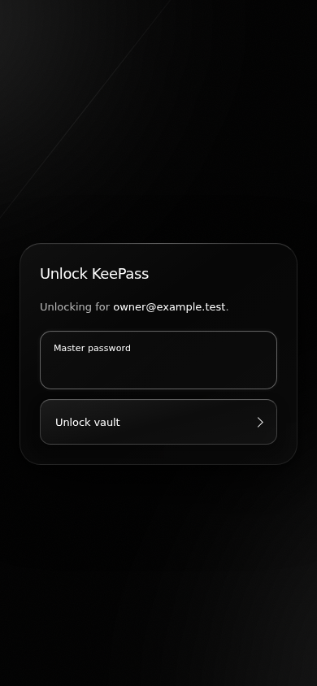
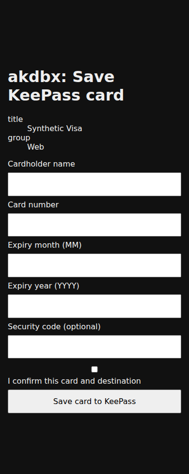
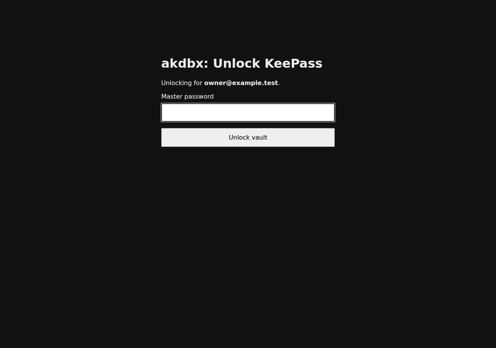
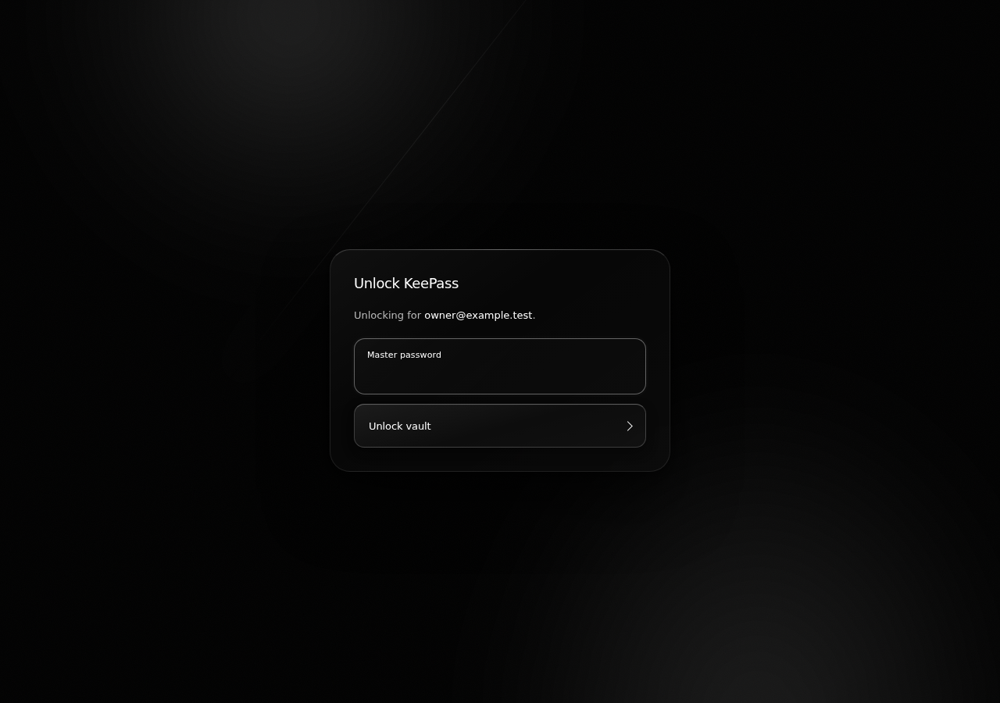

# Private portal design

The unlock and private save/import portals share the black frosted glass design
from agentic-handoff: a translucent black sheet, soft white lighting, a fine grain,
white field borders and glass buttons. The document keeps its akdbx identity;
each form keeps its destination details, warnings and confirmation controls.

The shared renderer covers unlock, password save, card save, authenticator setup,
QR import, import review and result/error pages. Labels are associated with their
inputs. Form names, types, limits, autocomplete hints and submission routes are
preserved. The existing response security headers remain in effect. The design
uses inline CSS/SVG and system fonts, with no new scripts or remote assets.

Motion follows the original design: an 800 ms sheet entrance, staggered fields,
slow ambient lighting and a subtle button glint. These effects run only with
`prefers-reduced-motion: no-preference`.

## Before and after

These screenshots use real HTTP-handler responses from an isolated synthetic
test vault. All entry/account details are synthetic, and secret fields are empty.
The baseline is commit `64713227a551890f3f59bfee5ac89fdc0050848b`.
The live broker was not changed or restarted for this review.

Mobile viewport: 390 × 844. Full-page captures retain scrolling content.

| Portal | Before | After |
| --- | --- | --- |
| Unlock |  |  |
| Card save |  |  |

Desktop viewport: 1280 × 900.

| Before | After |
| --- | --- |
|  |  |

## Validation

- 277 existing focused tests passed across web unlock, private writes, cards,
  authenticators, imports and upload contracts. One additional synthetic handler
  capture check passed (278 checks in that run).
- Chromium checked eight portal states at 320, 390 and 1280 pixels wide: unchanged
  form contracts, associated labels, no horizontal overflow and disabled motion
  under the reduced-motion preference.
- The raw captures and browser-check reports are kept in the local ignored
  `evidence/` directory; only the six synthetic review images are included here.

The existing regression tests can be run with:

```sh
python -m pytest -q tests/test_web_unlock.py tests/test_writes.py \
  tests/test_cards.py tests/test_totp.py tests/test_import_totp.py \
  tests/test_upload_contract.py
```
